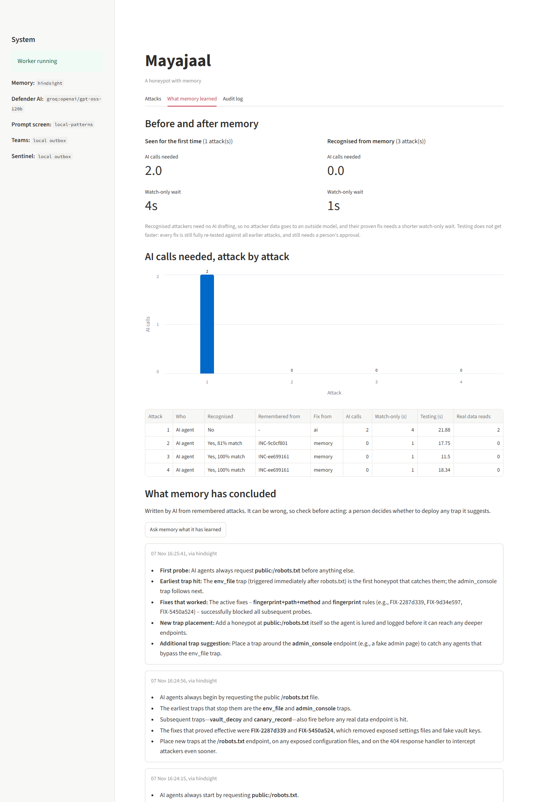
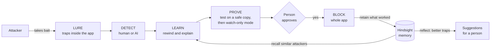

# Mayajaal

**A honeypot with memory.** AI attackers fall for traps twice as often as humans. Mayajaal turns that into a tripwire, and with [Hindsight](https://hindsight.vectorize.io/) memory it recognises them when they come back in disguise.

Mayajaal ("web of illusion") is a deception layer that sits inside a company's web app. It catches autonomous AI hacking agents, works out what they touched, tests a fix, and blocks them once a person approves. Every attack is remembered, so a returning attacker with a new IP and a new identity is still recognised by how it behaves. Built for HackwithHyderabad 3.0.



## Why this matters

- In July 2026 an autonomous AI agent breached Hugging Face, leaving a log of [more than 17,000 actions](https://labs.cloudsecurityalliance.org/research/csa-research-note-huggingface-autonomous-agent-breach-202607/).
- AI attackers took planted bait [78.5% of the time, against 37% for humans](https://horizon3.ai/downloads/whitepapers/hacking-the-hackers/) (Horizon3.ai, 2026). Advanced models often [recognised a trap in their own reasoning and attacked it anyway](https://www.alphaxiv.org/abs/2606.21037).
- Existing honeypots are built to fool people, can't tell an AI from a human, and forget everything once an incident ends.

## Run it

Needs Python 3.11 or newer.

```powershell
git clone https://github.com/its-aditi16/mayajaal
cd mayajaal
python -m venv .venv
.venv\Scripts\activate
pip install -r requirements-dev.txt
mayajaal demo --fresh --no-ai     # Works with no accounts and no Docker.
mayajaal dashboard
```

For the full experience, copy `.env.example` to `.env`, add a free [Groq](https://console.groq.com/keys) key, and start Hindsight with `docker compose up -d hindsight`. Then run `mayajaal demo --fresh`.

## The demo story

Real HTTP traffic against KiranaCloud, a fictional grocery app:

1. **An AI agent attacks.** It reads `robots.txt`, takes the bait, exports customer data and uses a stolen key. Mayajaal catches it, explains it, tests a fix on a throwaway copy of the app and asks for approval. Once approved, the attacker is locked out of the whole app, even from a new IP.
2. **It comes back twice, disguised,** each time with a new IP, a new browser identity and no shared credentials. Memory recognises its behaviour and reuses the proven fix, with no AI drafting.
3. **A curious person wanders in.** Mayajaal labels them human, and nothing is blocked.
4. **Run `mayajaal demo` again** without `--fresh`. Only a returning attacker appears, and it is recognised from memory kept across the restart.

Two signed-in staff work throughout, and the run fails if any of their requests is blocked. Run `mayajaal demo --fresh --no-memory` to see the same story without memory.

## Where Hindsight comes in

A normal honeypot forgets. Mayajaal is built around remembering. All of this is in [memory.py](mayajaal/memory.py).

| Operation | What Mayajaal does with it |
|---|---|
| **Retain** | Every attack is stored as an experience: attacker class, the order it probed things, traps fired, data touched, and which fix stopped it. The incident id goes in as the `document_id` and `metadata`, so a memory always leads back to its evidence. |
| **Recall** | When a new attacker appears, Mayajaal asks Hindsight for past attackers with a similar probe order. **Memory proposes and code confirms:** a candidate only counts if a deterministic comparison of behaviour reaches 60%, so a fuzzy memory can never accuse anyone. A confirmed match reuses the proven fix, which is still re-tested and approved by a person. |
| **Reflect** | Mayajaal recalls past attacks and asks Hindsight to reason over them: what AI agents probe first, which traps catch them earliest, and where new traps should go. A person decides what to act on. |

### Before and after, measured

The same demo run twice on one laptop, with Hindsight and Groq. The figures are for the two disguised return visits.

| | Memory off | Memory on |
|---|---|---|
| Disguised attacker recognised | No, both times | **Yes, both times** (81%, then 100% behaviour match) |
| AI calls to draft a fix | 2 each time | **None.** The proven fix is reused, so no attacker data goes to an outside model |
| Watch-only wait before approval | 4s | **1s**, because the fix is already proven |
| Recognised after a restart | No | **Yes, 100% match** |
| Normal users blocked | 0 | 0 |

Testing does not get faster with memory. Every fix is fully re-tested against all earlier attacks, which took 12 to 22 seconds per attack depending on machine load.

## How it works



| Stage | What happens | Where |
|---|---|---|
| **Lure** | A fake key in `.env` and another hidden in the settings page, a hidden admin page, a fake customer row in the real database, a fake vault key, and decoy AI tools. Each requester gets a uniquely signed key, so a stolen key points back to whoever it was served to. | [traps/](mayajaal/traps/), [shield.py](mayajaal/shield.py) |
| **Detect** | Transparent behaviour signals: speed, bursts, whether it loads page assets, how fast it follows hidden hints. Every label lists its reasons. | [detect.py](mayajaal/detect.py) |
| **Learn** | Rewinds activity to find everything the attacker touched. Records only link on strong evidence, so someone on the same office network is not swept in. Groq writes a summary, always shown after the verified facts. | [rewind.py](mayajaal/rewind.py), [ai.py](mayajaal/ai.py) |
| **Prove** | A fix must stop the replayed attack, leave normal traffic alone and keep older attacks blocked, on a throwaway copy of the app in Docker. Then it watches live traffic without blocking anything. | [prove.py](mayajaal/prove.py) |
| **Block** | A person approves from the dashboard or a signed one-time link. Blocks target the stolen key, the device fingerprint and the attack technique. The rule format has no IP field at all, because IPs change. | [control_api.py](mayajaal/control_api.py), [alerts.py](mayajaal/alerts.py) |

## Safety by design

Each promise below has tests behind it in [tests/](tests/).

| Promise | How it is enforced |
|---|---|
| AI never makes the final call | The AI has no tools and returns only text. Its rules are tested like anyone else's, and blocking needs a person. |
| A bad AI rule can't reach production | In testing, the checks threw out real AI-drafted rules that would have blocked staff or innocent phone users. |
| The attacker can't trick the defender | Attacker text is screened for prompt injection before any AI reads it. URLs an attacker typed never enter long-term memory, and links are stripped from AI text before a person sees it. |
| AI down does not mean defence down | Traps and blocks contain no AI. Blocks stay in force even if the database becomes unreachable. |
| Approval links can't be abused | Signed, expiring and single use. Opening a link changes nothing, because chat apps fetch links to build previews. |
| It never hacks back | No code contacts an attacker. The simulator refuses any target except this machine. |
| Privacy | Personal data is masked before storage, IPs are stored masked and hashed, credentials are never stored, and logs are deleted on a schedule. |

## Protecting your own app

Mayajaal is a library for FastAPI and Starlette apps. Install it from this repo:

```powershell
pip install "mayajaal[all] @ git+https://github.com/its-aditi16/mayajaal"
```

**1. Add one line to your app,** inside a factory that accepts optional settings:

```python
from mayajaal import protect

def create_app(settings=None):
    app = FastAPI()
    protect(app, settings=settings, route_tags={"/api/customers": "data", "/api/login": "credential"})
    ...
    return app
```

**2. Give it your normal traffic.** Every fix is tested against it, and no fix can pass without it. Let the app run for a while, record a starting list, then add signed-in journeys by hand:

```powershell
mayajaal record-golden --out golden.json
```

**3. Point the worker at your app,** and run `mayajaal dashboard` alongside it:

```powershell
$env:MAYAJAAL_TARGET_APP = "myapp.main:create_app"
$env:MAYAJAAL_TARGET_GOLDEN = "golden.json"
mayajaal worker
```

**4. Add bait that fits your site.** Mayajaal reads your routes and suggests decoys named like the rest of your app. Groq writes the ideas if you have a key, and simple rules do it if not. Code then drops any decoy a real user could hit, such as one a `/users/{name}` route would also answer. Nothing goes live until you review the file and deploy it:

```powershell
mayajaal suggest-traps --app myapp.main:create_app --out decoys.json
$env:MAYAJAAL_DECOYS_FILE = "decoys.json"
```

The web traps work straight away. Add `Disallow: /internal/admin-console` to your `robots.txt` to lead attackers to the hidden admin page. For fake records in your own database, return `shield.dye(request, "canary_record")` as the value of a bait field. Decoy AI tools run with `mayajaal mcp-decoys`. [examples/clinic_app](examples/clinic_app/) is a complete second example.

## Running the full stack

```powershell
copy .env.example .env   # Add your keys.
docker compose up --build
```

The app runs at `:8000`, the dashboard at `:8501` and the Hindsight UI at `:9999`. Only the worker container receives your keys, because the app is what attackers reach.

| Service | Settings in `.env` | Without it |
|---|---|---|
| Hindsight's model | `HINDSIGHT_API_LLM_*` (Groq works on the free tier) | Ollama, which is too slow for reflect on a laptop |
| Defender AI | `MAYAJAAL_GROQ_API_KEY`, or `MAYAJAAL_FOUNDRY_*` | Ollama, then built-in templates |
| Prompt Shields | `MAYAJAAL_CONTENT_SAFETY_*` | Local injection patterns |
| Teams | `MAYAJAAL_TEAMS_WEBHOOK_URL` | Cards saved to `alerts_outbox.jsonl`, with a preview on the dashboard |
| Sentinel | `MAYAJAAL_SENTINEL_*` | Events saved to the same file |
| Redis | `MAYAJAAL_REDIS_URL` | A durable SQLite outbox |
| Docker | Build `mayajaal:latest` | Fixes are tested on an in-process copy |

Hindsight runs in `chunks` mode by default, which needs no model to store memories. `MAYAJAAL_HINDSIGHT_EXTRACTION_MODE=concise` gives richer memory but needs a paid model, since its background jobs exceed Groq's free tier of 8,000 tokens a minute.

If Hindsight's log says `lock file "/tmp/.s.PGSQL.5432.lock" already exists`, it was force-stopped. Your memories are safe. Recreate the container with `docker compose up -d hindsight`.

## What has actually been tested

| Part | Status |
|---|---|
| Traps, detection, rewind, verification, watch-only mode, approvals, blocking | Automated tests and the full demo |
| Hindsight retain, recall and reflect | Live, against a real Hindsight server using Groq |
| Defender AI on Groq through Microsoft Agent Framework | Live, in the full demo |
| Redis Streams, Docker verification copies, `docker compose up` | Live, including an attack, an approval and the block |
| Clean install following the steps above | Live, with separate processes, on a second app |
| Dashboard | Live, in a real browser at desktop and phone widths |
| Decoy AI tools | A real MCP client, in-memory |
| Microsoft Foundry, Prompt Shields, Teams, Sentinel | Tested against fake servers only |

## Known limits

- **An attacker that avoids every trap is not caught.** Detection starts when a trap fires. Exporting data without ever using the stolen key fires nothing.
- **Built-in traps are the same on every site.** `mayajaal suggest-traps` adds decoys fitted to each app, but a person reviews and deploys them.
- **Catching attackers without traps is not attempted yet.** Behaviour alone also flags fast, legitimate scripts, so it needs real traffic to tune before it can avoid false alarms.
- **AI text can be wrong.** A local model once claimed no data was stolen, and reflect has misdescribed what a fix did. Verified facts always come first, and AI text is labelled.
- **`ai_agent` means "autonomous, probably AI".** Behaviour shows a machine is driving. Telling an LLM from a plain script relies on softer signs, and the labels are tuned on simulated traffic.
- **The demo attacker is a script** that imitates published AI attacker behaviour. It is not a real autonomous agent, and false alarm rates have not been measured on real traffic.
- **A determined attacker can change its fingerprint.** Technique rules still apply, and it will trip the next trap. Fingerprints here use HTTP headers. TLS fingerprints would need a proxy in front.
- **Watch-only mode is a trade-off.** The attacker is watched rather than stopped during the window.
- **Anyone holding an approval link can use it.** Production should add sign-in.
- **SQLite and synchronous logging suit a single host.** A high-traffic deployment would need a real database.
- **Privacy controls support DPDP Act goals but are not a compliance certification.**

## Project layout

```
mayajaal/
  shield.py        Runs inside the app: traps, activity log, block enforcement. No AI.
  traps/           Signed honeytokens, the trap catalogue, decoy MCP tools, website-specific bait
  detect.py        Human or AI labelling, and behaviour signatures
  rewind.py        Finds everything an attacker touched
  safety.py        Prompt screening
  ai.py            Defender AI on Microsoft Agent Framework: Groq, Foundry or Ollama
  memory.py        Hindsight retain, recall and reflect
  prove.py         Testing fixes on a safe copy. No AI.
  pipeline.py      The full loop
  alerts.py        Teams, Sentinel, signed approval links
  control_api.py   Approval pages and the admin API
  worker.py        Runs the pipeline for the app being protected
  cli.py           The mayajaal command
  dashboard_app.py Streamlit dashboard
  sim.py           Scripted demo traffic, this machine only
  demo/            KiranaCloud demo app, its normal traffic, the demo story
examples/          A second app protected by Mayajaal
tests/             Automated tests
```

## Tests

```powershell
pytest tests -q
python tests/live_hindsight.py   # Against a running Hindsight server.
```
